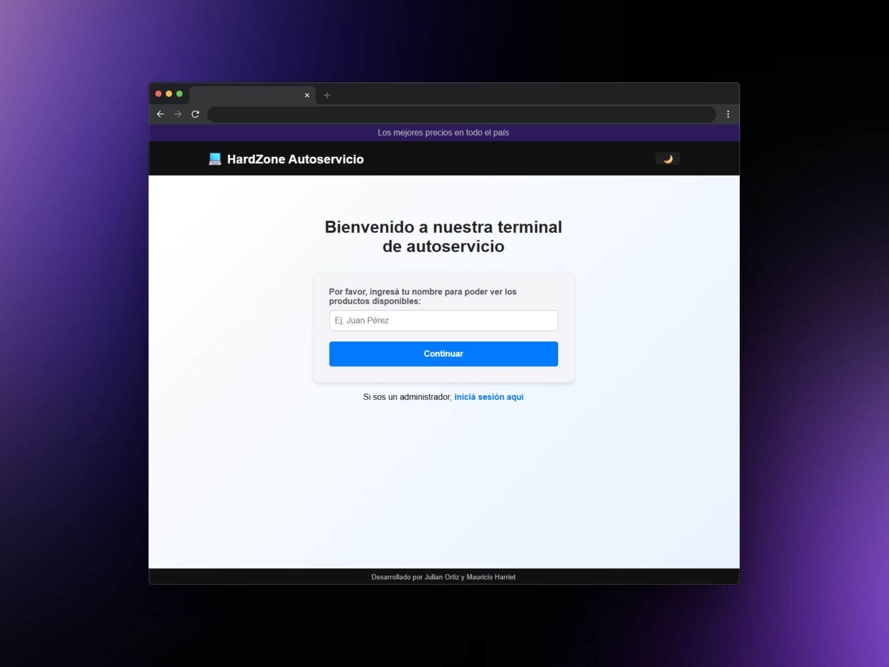

# HardZone - Sistema de Autoservicio

## Descripción del Proyecto
**HardZone** es un sistema completo de autoservicio para la venta de hardware y perifericos, desarrollado como Trabajo Integrador Final de la materia de Programación III de la Tecnicatura en Programación de la Universidad Tecnologica Nacional (UTN). 

El sistema simula un e-commerce con estilo de autoservicio (similar a los terminales de comida rapida), donde los clientes pueden:
- Seleccionar los productos de manera autónoma y rapida.
- Gestionar su carrito de compras.
- Finalizar la compra y recibir un ticket.
